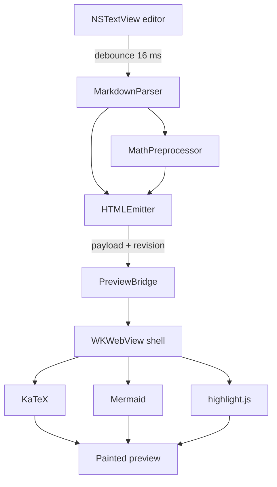
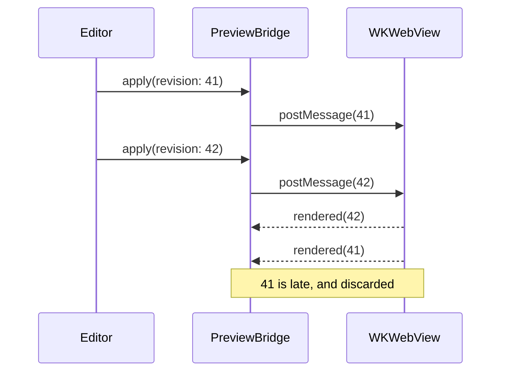

# The Preview Render Pipeline

Markdown reaches the preview through four hops: parse, emit, bridge, render.
Only the first two are Swift; the last two live in the `WKWebView`.

## Why the revision number matters

The bridge is asynchronous in both directions, so a slow Mermaid render can
land after the document has already moved on. Every payload carries a
monotonic revision, and the web side drops anything older than what it has
already painted.

## Failure modes we have actually seen

- **Blank preview on cold launch.** The shell had not signalled `ready`
  before the first payload was posted. Fixed with a ready-retry.
- **Stale diagram after an undo.** A cached Mermaid SVG was keyed on the
  block id alone, not on the source hash.
- **Scroll jump while typing.** The sync echoed its own scroll back; now
  gated on an expected-position handshake, and only in Split mode.
